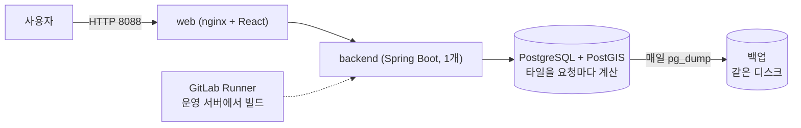
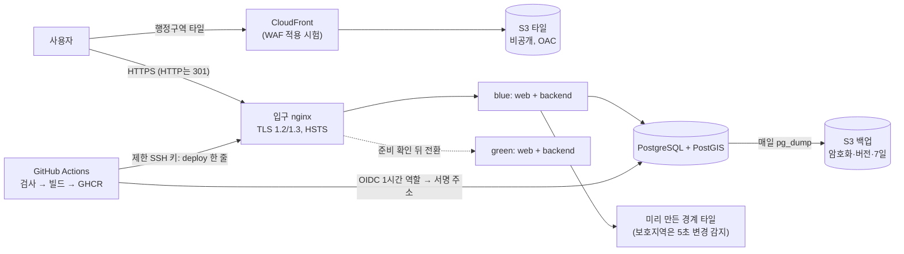

# Terre 인프라 재설계: 단일 서버 진단부터 무중단 배포까지

SSAFY 기업연계 프로젝트 Terre의 단일 서버 구성을 기준점으로 고정하고, 운영과 분리한 실험실에서 **직접 진단 → 개선 설계 → 같은 조건 재측정**으로 검증한 인프라 포트폴리오입니다.

## 결과 한눈에

| 영역 | 목표 | 개선 전 | 개선 후 | 판정 |
| --- | --- | --- | --- | --- |
| 지도 타일 | 동시 50명 p95 1초 이하 | 목표를 지킨 최대 **0명**, 50명 p95 11.4초 | 최대 **75명**, 50명 p95 **0.31초** | 달성 |
| 사업장 분석 | 동시 50명 p95 1초 이하 | 최대 10명, 50명 p95 4.9~5.1초 | 최대 25명, 50명 p95 3.6초 | 개선 |
| 배포 | 배포 중 실패 0건 | 실패 13.6%, 43.8초 끊김 | **실패 0건 / 4,200건**, 끊김 0초 | 달성 |
| 백업 위치 | 서버 밖 사본 | 같은 디스크만 | 매일 S3(암호화·버전 관리), 서버에 AWS 키 없음 | 달성 |
| 백업 주기(RPO) | 1시간 이내 | 최대 24시간 | 최대 24시간(그대로) | 미달(설계만) |
| 입구 | 밖에 열린 앱 포트 0개 | 앱 포트 8088 노출, HTTPS 없음 | HTTPS 입구 하나, 앱 컨테이너 공개 포트 0개(실험실) | 달성(실험실) |

- '0명'은 가장 낮은 10명 단계부터 p95가 1.4초로 목표를 넘어, 통과한 단계가 하나도 없었다는 뜻입니다.
- 수치는 CPU 2개·메모리 4GB로 묶은 실험실 값입니다. 운영 성능 그 자체가 아니라 같은 조건의 전후 비교입니다.
- push 한 번으로 검사 → 빌드 → 무중단 배포까지 3분 56초. AWS 비용은 합계 1달러 미만입니다.

## 구조

**개선 전 (11/6 기준)**: 서버 1대가 입구·앱·DB·백업·빌드를 모두 맡는 구조

**개선 후 (실험실)**: 반복되는 것·보관할 것·바깥 입구를 서버에서 떼어 낸 구조

## 문서

| 문서 | 내용 |
| --- | --- |
| [1·2. 프로젝트와 기존 인프라](docs/01-project-and-baseline.md) | 맡은 역할, 11/6 기준 단일 서버 구성 |
| [3. 문제점과 근거](docs/02-diagnosis.md) | 실험실에서 부하·배포·복원·장애 시험으로 진단한 문제 4가지 |
| [4. 비교와 개선 설계](docs/03-design.md) | 문제마다 선택지를 비교하고 고른 이유 |
| [5. 업그레이드 결과](docs/04-results.md) | 같은 조건 재측정 결과와 한계 |
| [6·7. 비용·제약, 배운 점](docs/05-cost-and-lessons.md) | 비용, 하지 않은 것, 시행착오에서 배운 점 |

## 코드 (`infra/`)

실험실에서 실제로 돌린 인프라 코드입니다. 앱 코드는 팀 저작물이라 포함하지 않았습니다.

| 경로 | 하는 일 |
| --- | --- |
| `infra/lab.sh`, `compose.lab.yml` | 운영과 분리된 실험실 띄우기·시험·정리, 자원 상한과 운영 감시 |
| `infra/k6/` | 부하 시나리오(팀이 11/5에 만든 시나리오를 재사용) |
| `infra/pregen/` | 경계 타일 미리 생성, 보호지역 변경 감지, S3 업로드 |
| `infra/bluegreen/` | 블루-그린 배포(`bg.sh`), 입구 nginx(`edge.conf`), 제한 키 전용 입구(`gha-deploy.sh`), S3 백업(`gha-backup.sh`), TLS |
| `infra/github-workflows/` | GitHub Actions 배포·백업 워크플로 (이 저장소에서 실행되지 않도록 `.github/` 밖에 둠) |
| `infra/aws/` | S3 백업 버킷과 OIDC 역할 설정 명령 |
| `infra/tools/` | 진단·점검 스크립트 |

버킷 이름, 도메인, 계정 정보 같은 식별 값은 자리표시자로 바꿨습니다.

## 기술 스택

Docker Compose · nginx · PostgreSQL/PostGIS · k6 · GitHub Actions · GHCR · AWS (S3, CloudFront, WAF, IAM, OIDC) · Bash · Python
