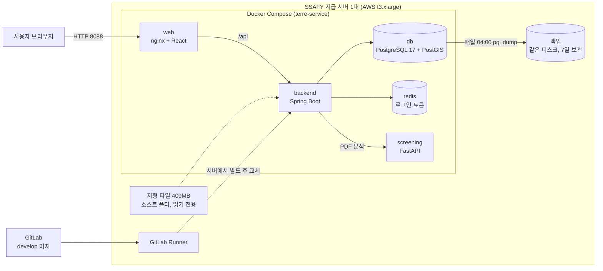

# 1. 프로젝트와 내 역할

SSAFY 기업연계 프로젝트 Terre에서 인프라 설계를 맡았다. 이 포트폴리오에서는 운영 중이던 구성을 기준점으로 삼아 직접 문제를 진단하고, 다시 설계한 구성을 같은 조건에서 전후 수치로 검증한다.

## 프로젝트

- **Terre**: 사업장 주변의 보호지역·보호종을 진단하고, 대응 활동을 추천해 공시 보고서까지 만드는 웹 서비스 (SSAFY 기업연계 자율 프로젝트, 2026년 10~11월)
- **기술 구성**: React, Spring Boot, FastAPI, PostgreSQL + PostGIS, Redis, Docker Compose, GitLab CI

## 팀 프로젝트에서 맡은 일

| 영역 | 한 일 |
| --- | --- |
| 요구사항·구조 분석 | 가용 자원·기능 흐름·데이터 규모를 정리하고, 서비스별 실행 위치·통신·저장·빌드 의존성을 분석 |
| 설계·비용 | 서버 1대 배치안과 시연 시간 배포 중단 원칙을 세우고, 같은 사양의 AWS 요금 기준 비용을 산정(월 약 84달러) |
| 구축 검증·인계 | 지급 서버의 포트·볼륨·권한·백업·cron을 설계와 대조하고, 재구성·인계 절차를 작성 |
| 성능 정책 | 지도 타일 캐시를 재검증(ETag) 방식으로 바꿔 자료 교체 뒤 옛 타일이 보이던 문제를 해결하고, 측정 근거가 없는 서버 캐시 도입은 보류 |
| 운영 비용 측정 | 서버 자원 사용 표본 571개를 집계해 예상 비용을 같은 기간으로 환산 |
| AI 문서 분석 연동 | 할당 GPU 서버에서 OCR 추론을 검증하고, GPU가 서버의 분석 작업을 가져가는 연결 모듈을 만들어 격리 시험. 운영 인계 문서 작성 |
| CI | 문서 변경 MR을 검사하는 CI 작업(docs-check) 추가 |

## 이 포트폴리오에서 하는 일

1. 11/6 운영 구성을 기준점(스냅샷)으로 고정
2. 직접 만든 읽기 전용 점검 스크립트로 서버 상태 확인
3. 같은 서버에 운영과 분리된 실험 환경(terre-lab)을 만들고, 부하·배포·복구·장애 테스트로 문제를 진단
4. 개선 설계(타일 미리 생성·S3+CloudFront, 블루-그린 배포, S3 백업, HTTPS 입구) 뒤 같은 자원 조건에서 전후 비교
5. 개인 GitHub 저장소에 GitHub Actions 파이프라인(검사 → 빌드 → 무중단 배포, 매일 S3 백업) 구성

# 2. 기존 인프라 (11/6 기준)

SSAFY가 지급한 서버 1대에 Docker Compose로 서비스 5개를 띄운 단일 서버 구성이다. 아래 값은 11/6에 직접 만든 읽기 전용 점검 스크립트로 서버 안과 바깥에서 확인했다.

## 서버

| 항목 | 값 |
| --- | --- |
| 인스턴스 | AWS t3.xlarge (vCPU 4개, 메모리 15.8GB), 서울 리전 ap-northeast-2a |
| 디스크 | 309GB 중 57GB 사용 (19%) |
| OS | Ubuntu 24.04 |
| 접근 권한 | SSH만 가능. 콘솔·보안 그룹·IAM은 바꿀 수 없음 |
| 바깥에 열린 포트 | 22(SSH), 8088(web) |

## 서비스 5개

| 서비스 | 하는 일 | 바깥 노출 | 메모리 상한 |
| --- | --- | --- | --- |
| web | nginx로 React 화면을 주고, /api 요청을 backend로 넘김 | 8088 (모든 주소) | 256MB |
| backend | Spring Boot API. 지도 타일은 요청마다 DB(PostGIS)가 만들어 보냄 | 없음 | 2GB |
| db | PostgreSQL 17 + PostGIS 3.5 | 서버 안(127.0.0.1)만 | 2GB |
| redis | 로그인 토큰 저장 | 서버 안(127.0.0.1)만 | 512MB |
| screening | FastAPI 기반 PDF 문서 분석 | 없음 | 1GB |

모든 컨테이너에 메모리 상한, 로그 상한(10MB × 5개), 자동 재시작이 걸려 있고, CPU 상한은 없다. backend는 요청을 받을 준비가 됐는지(readiness)를 Docker가 직접 확인한다.

## 데이터

| 데이터 | 크기 | 내용 |
| --- | --- | --- |
| DB | 301MB | 공공 기준 데이터 위주(보호종 62,604건, 보호지역 19,986건 등), 스키마 버전 V28 |
| 업로드 파일 | 0개 | 사용 기록은 아직 비어 있음 |
| 지형 타일 | 409MB | 원본에서 다시 만들 수 있음 |
| Redis | 약 0.5MB | 로그인 토큰 |
| DB 백업 1개 | 약 110MB | gzip 압축 |

## 배포

- MR마다 바뀐 영역의 테스트를 실행한다(문서 검사 포함).
- develop에 머지되면 서버의 GitLab Runner가 운영 서버에서 이미지를 빌드하고, 바뀐 컨테이너를 그 자리에서 교체한다(`docker compose up -d --build`).
- 교체 뒤 web 응답(200)과 backend 상태(UP)를 확인하고, 롤백용으로 서비스마다 이미지 태그 5개를 남긴다.
- main 배포는 같은 과정을 수동 승인으로 실행한다.
- 서버가 GitLab 이미지 저장소(Container Registry)에 접속할 수 없어서, 이미지를 운영 서버에서 직접 만든다.

## 백업

- 매일 04:00(한국 시간) cron이 pg_dump로 DB를 gzip 백업해 같은 서버 디스크에 7일 보관한다.
- 업로드 파일·Redis·설정 파일은 백업 대상이 아니다.
